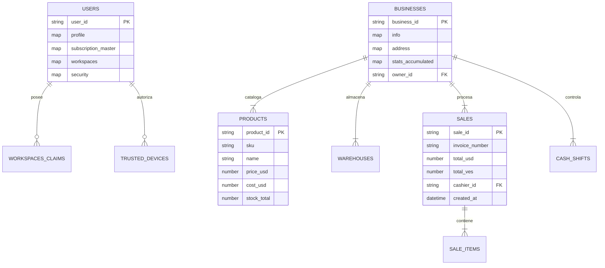

# Esquema de Base de Datos Firestore v4.0.0 (B.U.C.A. AI)

> **Documento:** Estructura de Datos NoSQL, Colecciones, Subcolecciones y Reglas de Optimización  
> **Versión:** 4.0.0 (Master de Producción)  
> **Motor:** Google Cloud Firestore (Modo Nativo)

---

## 1. Reglas de Optimización para la Capa Gratuita (Spark Free Plan)

Para garantizar la viabilidad del presupuesto operativo de **$0.00 USD** (50,000 lecturas y 20,000 escrituras diarias):
1. **Contadores Acumulados por Snapshot:** Prohibido actualizar documentos principales en cada venta individual. Los totales de ventas se acumulan en memoria/estado local y se consolidan en Firestore una vez al día o al cerrar el turno de caja (`cash_shifts`).
2. **Paginación Obligatoria con Cursores:** Toda consulta de listado (productos, clientes, ventas) debe usar `limit(20)` y `startAfter(ultimoDocumento)`. Prohibido el uso de consultas abiertas (`getDocs` sin límites).
3. **Caché en Cliente:** Las configuraciones estáticas y tasas de cambio se leen una sola vez al iniciar sesión y se almacenan en `StorageAdapter` (IndexedDB / LocalStorage) con un TTL de 4 horas.
4. **Nomenclatura en Plural:** Todas las colecciones principales se nombran estrictamente en minúsculas y plural (`users`, `businesses`, `products`, `sales`).

---

## 2. Mapa Global de Colecciones

---

## 3. Diccionario de Colecciones Principales

### 3.1. Colección `/global_config/main` (Configuración del Sistema)
* **`rates` (Map):**
  * `usd` (Number): Tasa oficial BCV en Bolívares (ej. `382.63`).
  * `eur` (Number): Tasa oficial Euro en Bolívares.
  * `binance_usdt` (Number): Tasa de referencia USDT P2P.
  * `pessimistic_replacement_rate_max` (Number): Tasa de reposición preventiva para proteger el inventario ante saltos cambiarios.
  * `calculationStrategy` (String): `'SMART'` (usa brecha cambiaria) o `'STRICT'` (solo oficial).
  * `updated_at` (Timestamp): Última fecha de sincronización automática.

---

### 3.2. Colección `/users/{user_id}` (Usuarios y Cuentas Híbridas)
* **`profile` (Map):**
  * `username` (String): Alias único de usuario.
  * `role` (String): Rol global en la plataforma (`super_admin`, `admin`, `owner`).
  * `firstName`, `lastName` (String): Nombre y apellido del titular.
  * `mail` (String): Correo electrónico verificado.
  * `phone` (String): Teléfono internacional.
  * `avatar_url` (String): URL de imagen de perfil en Firebase Storage.
* **`subscription_master` (Map):**
  * `plan_tier` (String): `'free'`, `'silver'`, `'gold'`.
  * `max_businesses` (Number): Límite de negocios propios según el plan activo.
  * `status` (String): `'active'`, `'past_due'`, `'canceled'`.
* **`workspaces` (Map de Negocios Afiliados):**
  * `{business_id}` (Map):
    * `role` (String): Rol en el negocio específico (`owner`, `manager`, `cashier`, `inventory`).
    * `status` (String): `'active'`, `'suspended'`.
    * `permissions_hash` (String): Hash SHA-256 de permisos y claims autorizados.
* **`trusted_devices` (Map):**
  * `{device_id}` (Map): Huella digital del navegador (`fingerprint`), nombre descriptivo (`"PC Caja 1"`), IP reciente y estado de aprobación (`approved` / `pending`).

---

### 3.3. Colección `/businesses/{business_id}` (Unidades de Negocio ERP)
* **`info` (Map):**
  * `name` (String): Razón social registrada.
  * `commercial_name` (String): Nombre comercial visible.
  * `rif` (String): Registro de Información Fiscal (ej. `J-12345678-9`).
  * `email`, `phone` (String): Datos de contacto de la sede.
  * `category` (String): `'retail'`, `'food'`, `'services'`, `'wholesale'`.
  * `owner_id` (String): UUID del usuario creador (Owner soberano).
* **`stats_accumulated` (Map de Contadores):**
  * `total_sales_count` (Number): Cantidad total histórica de transacciones.
  * `total_sales_usd` (Number): Facturación histórica acumulada en Dólares.
  * `total_sales_ves` (Number): Facturación histórica acumulada en Bolívares.

---

## 4. Subcolecciones Operativas de Negocio (`/businesses/{business_id}/...`)

1. **`products` (`/products/{product_id}`):**
   * `sku` (String), `barcode` (String), `name` (String), `category_id` (String).
   * `price_usd` (Number): Precio base fijado en moneda dura.
   * `cost_usd` (Number): Costo de adquisición unitario.
   * `stock_total` (Number): Sumatoria de existencias en todos los almacenes.
   * `min_stock_alert` (Number): Umbral para disparar alerta de desabastecimiento.
2. **`sales` (`/sales/{sale_id}`):**
   * `invoice_number` (String), `customer_id` (String), `cashier_id` (String).
   * `items` (Array de Maps): Lista de productos vendidos, cantidades y precios congelados al momento de la venta.
   * `rate_applied` (Number): Tasa de cambio exacta utilizada en la transacción.
   * `total_usd`, `total_ves` (Number): Montos bi-monetarios totales.
   * `payment_methods` (Array): Detalle de cobro (Efectivo USD, Punto de Venta VES, Pago Móvil, Zelle, USDT).
3. **`cash_shifts` (`/cash_shifts/{shift_id}`):**
   * Control de apertura y cierre de caja: monto inicial en caja, ventas en efectivo por moneda, retiros parciales y arqueo ciego final para evitar hurtos o discrepancias.
4. **`warehouses` (`/warehouses/{warehouse_id}`):**
   * Ubicaciones físicas o depósitos con stock desglosado por lote y vencimiento.
