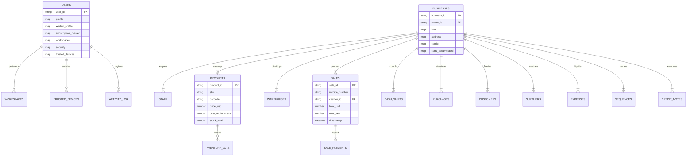

# Esquema de Base de Datos Firestore v4.1.0 (B.U.C.A. AI)

> **Documento:** Estructura de Datos NoSQL, Colecciones, Subcolecciones, Badges y Reglas de Optimización  
> **Versión:** 4.1.0 (Master de Producción - Arquitectura Híbrida)  
> **Motor:** Google Cloud Firestore (Modo Nativo)  
> **Filosofía de Arquitectura:** Resiliencia Anti-Crisis, Aislamiento Multi-Tenant y Coste Operativo $0.00 USD

---

## 1. Reglas de Optimización para la Capa Gratuita (Spark Free Plan)

Para operar de forma indefinida con un presupuesto de **$0.00 USD** (50,000 lecturas diarias, 20,000 escrituras diarias y 1 GB de almacenamiento):

1. **Patrón de Contadores por Snapshot:** Prohibido actualizar el documento raíz del negocio en cada ticket de venta individual. Los totales diarios se mantienen en memoria del navegador o en un documento de turno (`cash_shifts`), consolidándose en el negocio una sola vez al día.
2. **Paginación Obligatoria con Cursores:** Todo listado de datos (`products`, `sales`, `customers`, `purchases`) implementa `limit(20)` y `startAfter(ultimoDoc)`. Se prohíben lecturas abiertas (`getDocs` sin límites).
3. **Caché en Cliente con TTL:** Datos estáticos de configuración y tasas se leen una sola vez al inicio de sesión y se persisten en `StorageAdapter` (IndexedDB / LocalStorage) con un TTL de 4 horas.
4. **Atomicidad con `runTransaction`:** Los consecutivos de facturas (`sequences`) deben incrementarse mediante transacciones atómicas para prevenir duplicados en ventas concurrentes.
5. **Nomenclatura Canónica en Plural:** Todas las colecciones y subcolecciones se nombran estrictamente en minúsculas y plural (`users`, `businesses`, `products`, `sales`, `warehouses`, `cash_shifts`).

---

## 2. Mapa Global de Colecciones y Relaciones

El sistema B.U.C.A. AI organiza los datos en colecciones raíz globales y subcolecciones aisladas por inquilino (*Multi-Tenant Scoped*):



---

## 3. Matriz de Colecciones, Badges y Roles

| Colección / Ruta | Tipo | Badges de Arquitectura | Rol de Acceso | Propósito y Función Crítica |
| :--- | :--- | :--- | :--- | :--- |
| `/global_config/main` | Raíz | `[Spark $0.00 Cost Guard]` `[Real-Time Cache]` | Público / Lectura | Tasas oficiales BCV, paralelo, reposición pesimista y estrategias de cálculo. |
| `/activity_log/{log_id}` | Raíz | `[Zero Stack Traces]` `[TTL 30 Days]` | `super_admin` `admin` `owner` | Bitácora de auditoría inmutable del sistema (logins, fallos de seguridad, bloqueos). |
| `/notifications/{notif_id}` | Raíz | `[Event-Driven]` `[Read-By Array]` | Todos los Roles | Avisos de stock crítico, cambios bruscos de tasa y contrataciones de personal. |
| `/users/{user_id}` | Raíz | `[Hybrid: Owner/Worker]` `[2FA Challenge]` | Propietario UID / Admin | Cuenta híbrida de usuario, perfil personal, suscripción y dispositivos confiables. |
| `/businesses/{business_id}` | Raíz | `[Multi-Tenant Scoped]` `[Snapshot Pattern]` | `owner` (Propiedad) / Staff | Entorno ERP del comercio, datos fiscales, balances acumulados y configuración. |
| `.../workspaces/{biz_id}` | Subcolección | `[Hybrid: Owner/Worker]` `[Display Cache]` | Usuario UID | Negocios vinculados al usuario, clasificados en **Mis Propiedades** o **Colaboraciones**. |
| `.../staff/{user_id}` | Subcolección | `[Bilateral Reputation]` `[Claims Scoped]` | `owner` / `manager` | Nómina activa de colaboradores en un negocio, roles asignados y turnos. |
| `.../roles/{role_id}` | Subcolección | `[Custom RBAC]` `[Immutable Owner]` | `owner` | Definición de roles propios del negocio (Cajero, Almacenista, Auditor, Gerente). |
| `.../categories/{cat_id}` | Subcolección | `[Catalog Structure]` | `owner` `worker` | Clasificación de inventario (Alimentos, Ferretería, Farmacia, Servicios). |
| `.../warehouses/{wh_id}` | Subcolección | `[Multi-Depository]` | `owner` `inventory` | Almacenes físicos y depósitos sucursales para control de existencias. |
| `.../products/{prod_id}` | Subcolección | `[Bi-Monetary Pricing]` `[Search Keywords]` | `owner` `worker` | Ficha técnica de producto, códigos de barra, stock total y márgenes comerciales. |
| `.../inventory_lots/{lot_id}`| Subcolección | `[FIFO Traceability]` `[Expiration Alert]` | `owner` `inventory` | Trazabilidad por lote de compra, fecha de vencimiento y costo de reposición. |
| `.../sales/{sale_id}` | Subcolección | `[Immutable Fiscal Snapshot]` `[POS]` | `owner` `cashier` | Registro congelado de la venta, desglose multi-moneda, vuelto y tributos. |
| `.../cash_shifts/{shift_id}` | Subcolección | `[Blind Cash Count]` `[Cash Shift]` | `owner` `cashier` | Control de apertura y cierre ciego de caja registradora para evitar hurtos. |
| `.../purchases/{purch_id}` | Subcolección | `[Auto Cost Update]` | `owner` `admin` | Compras a proveedores, recepción de mercancía y actualización de costo promedio. |
| `.../customers/{cust_id}` | Subcolección | `[Credit Ledger (Fiado)]` | `owner` `cashier` | Directorio de clientes con cuenta corriente y límite de crédito comercial anclado en USD. |
| `.../suppliers/{supp_id}` | Subcolección | `[Accounts Payable]` `[Risk Profile]` | `owner` `purchases` | Proveedores registrados, deuda pendiente en divisas y términos de reposición. |
| `.../expenses/{exp_id}` | Subcolección | `[Overhead Tracking]` | `owner` `manager` | Egresos operativos (pago de nómina, alquiler, servicios públicos, mantenimiento). |
| `.../sequences/{seq_id}` | Subcolección | `[Atomic Transaction]` `[Fiscal Sequence]` | Cloud Function / POS | Contadores atómicos con prefijo y padding para facturas fiscales (`FAC-`, `NC-`, `TKT-`). |
| `.../credit_notes/{note_id}` | Subcolección | `[Return Voucher]` | `owner` `cashier` | Notas de crédito emitidas para devoluciones sin alterar ventas originales. |

---

## 4. Reingenierías Críticas: Diagnóstico de Errores y Soluciones de Futuro

Esta sección detalla los problemas de arquitectura descubiertos en el análisis del sistema que habrían provocado colapso en producción, alto consumo de cuotas en Firebase o corrupción contable, junto con sus soluciones definitivas.

---

### 4.1. Reingeniería 1: `users/{user_id}/workspaces/{business_id}` y el Modelo Híbrido

#### ⚠️ Problemas y Riesgos Detectados en el Modelo Legacy:
1. **Límite de 1 MB de Firestore:** Guardar un mapa plano de negocios indefinido en la raíz del usuario sobrecarga el documento en perfiles con muchas colaboraciones históricas.
2. **Agotamiento de Lecturas (Problema N+1):** Si solo se guardaba el ID y el rol, al iniciar sesión el frontend tenía que hacer `N` lecturas adicionales a `businesses/{biz_id}` solo para saber el nombre y logo de cada tarjeta del carrusel.
3. **Falta de Separación Híbrida:** No había distinción clara entre lo que el usuario posee como dueño y los comercios donde presta servicios como empleado.

#### 🚀 Estructura Evolucionada en B.U.C.A. AI v4.1.0:
```text
📂 users/{user_id}/workspaces/{business_id}
├── 🔤 membership_type: "owner" | "worker"                   # Divide 'Mis Propiedades' vs 'Mis Colaboraciones'
├── 🔤 role: "owner" | "manager" | "cashier" | "inventory"   # Puesto de trabajo
├── 🔤 status: "active" | "suspended"
│
├── 📦 display_cache                                         # 💡 CACHÉ PARA RENDERIZAR EN 0ms
│    ├── 🔤 business_name: "Inversiones Mega Center C.A."
│    ├── 🔤 commercial_name: "Mega Center"
│    ├── 🔤 logo_url: "https://.../logo.webp"
│    ├── 🔤 category: "retail"
│    ├── 🔤 location: "Valencia, Carabobo"
│    └── 🔤 currency_base: "USD"
│
├── 💠 claims: ["pos:sell", "pos:discount", "cash:shift"]    # Permisos granulares listos para el cliente
├── ⚖️ device_restricted: true                               # Exige conectarse desde PC/móvil autorizado
├── 🔢 reputation_score: 4.9                                 # Reputación bilateral acumulada
├── 🔗 invited_by: "uid_owner"                               # Trazabilidad de contratación
├── 🕒 joined_at: TIMESTAMP
└── 🕒 last_accessed_at: TIMESTAMP                           # Para ordenar recientes en el Dock
```

---

### 4.2. Reingeniería 2: Tratamiento del Rol `[Worker]` en `users/{user_id}`

#### ❓ El Dilema Arquitectónico:
¿Debe agregarse `role: "worker"` dentro del mapa `profile` o en `subscription_master` de la colección `users/{user_id}`?

#### 💡 Solución Canónica B.U.C.A. AI:
En nuestra filosofía de libertad económica, **un usuario nunca es degradado a un rol fijo**. Todos los usuarios registrados tienen una **Cuenta Híbrida Dual** capaz de operar como Owner y como Worker simultáneamente:

1. **En `profile`:**
   * `platform_role`: Define únicamente el nivel de sistema (`'super_admin'`, `'admin'`, `'user'`).
   * `active_mode`: Almacena el interruptor visual activo de la interfaz (`'owner'` para Mis Propiedades, `'worker'` para Mis Colaboraciones).
2. **Nuevo Mapa `worker_profile` (El Perfil Laboral del Usuario):**
   Para permitir que el usuario sea contratado en el ecosistema, se crea un mapa específico para su faceta de trabajador:
   ```text
   📦 worker_profile
   ├── 💠 skills: ["pos_cashier", "inventory_auditor", "sales_expert"]
   ├── 🔤 job_title: "Cajero Principal y Operador POS"
   ├── 🔤 bio: "3 años de experiencia en manejo de caja bi-monetaria y arqueo ciego."
   ├── 🔤 availability_status: "available" | "busy" | "not_disturb"
   ├── 🔢 reputation_score: 4.88           # Promedio de calificaciones de Owners
   └── 🔢 total_shifts_completed: 142     # Conteo de turnos exitosos
   ```
3. **¿Cómo afecta a `subscription_master`?**
   * El plan de suscripción (`Free`, `Silver`, `Gold`) **aplica únicamente a la faceta de Owner** (determina cuántas empresas propias puede crear).
   * **La faceta de Worker es 100% gratuita e ilimitada de por vida.** Un trabajador puede ser contratado en 100 negocios distintos sin pagar suscripción alguna.
4. **¿Cómo afecta a `security` y `trusted_devices`?**
   * Aplican globalmente para proteger el inicio de sesión del usuario.
   * Si un negocio ajeno tiene activada la política `device_restricted: true`, el trabajador solo podrá ingresar a ese negocio específico si su huella digital coincide con un dispositivo previamente autorizado por el dueño de dicho negocio.

---

### 4.3. Reingeniería 3: Anclaje de Deuda Multi-Moneda en `customers.credit_account` (El "Fiado")

#### ⚠️ Problema Crítico:
En economías de alta inflación, registrar una deuda de cuenta corriente ("fiado") en moneda local (VES) provoca que en pocas semanas el dinero cobrado no cubra ni una fracción del costo del producto, causando la quiebra silenciosa del comercio.

#### 🚀 Solución:
Toda cuenta corriente se ancla estrictamente en **Dólares ($ USD)** en el campo `balance_usd`:
* Al momento de abonar o cancelar la deuda, el sistema multiplica el `balance_usd` por la tasa oficial BCV del día exacto del cobro.
* De este modo, el negocio conserva íntegro su poder adquisitivo y su capital de trabajo sin vulnerar el marco legal cambiario.

---

### 4.4. Reingeniería 4: Inmutabilidad Fiscal Absoluta en `sales`

#### ⚠️ Problema Crítico:
Si un documento de venta solo almacena el `productId` y consulta el precio o costo en la colección de productos al generar un reporte, cualquier actualización posterior de precios o costos corromperá retroactivamente las ganancias y balances de ventas del año pasado.

#### 🚀 Solución:
Cada documento en `/sales/{sale_id}` almacena un **Snapshot Inmutable Completo** dentro de su array `items`:
* Nombre del producto al momento de la venta.
* Precio unitario de venta congelado (`price_unit_usd`).
* Costo real de adquisición del lote en ese segundo (`cost_snapshot`).
* Tasa de cambio oficial aplicada en ese instante (`rate_applied`).
* Porcentaje de IVA e IGTF vigentes en ese ticket.

---

### 4.5. Reingeniería 5: Concurrencia en Consecutivos Fiscales (`sequences`)

#### ⚠️ Problema Crítico:
Si dos cajas en una tienda cobran simultáneamente a las 12:00:00 y leen el contador de facturas mediante lecturas estándar (`getDoc`), ambas recibirán el número 1050 y emitirán dos facturas distintas con el mismo consecutivo fiscal (`FAC-001050`), generando una grave falta legal y tributaria.

#### 🚀 Solución:
Uso estricto de transacciones atómicas (`runTransaction` en Firebase Cloud Functions):
```javascript
await db.runTransaction(async (transaction) => {
    const seqDoc = await transaction.get(seqRef);
    const nextVal = seqDoc.data().current_value + 1;
    transaction.update(seqRef, { current_value: nextVal });
    return `${prefix}${String(nextVal).padStart(padding, '0')}`;
});
```

---

### 4.6. Reingeniería 6: Trazabilidad FIFO por Lotes (`inventory_lots`)

#### ⚠️ Problema Crítico:
Manejar un stock numérico simple (`stock: 50`) impide saber cuáles productos caducan primero en rubros como alimentos, bebidas o farmacia, provocando pérdidas por vencimiento de mercancía.

#### 🚀 Solución:
Subcolección `/products/{product_id}/inventory_lots/{lot_id}`:
* Cada compra entrante crea un lote con su fecha de vencimiento (`expiration_date`) y costo unitario real.
* El Punto de Venta descuenta inventario siguiendo la regla **PEPS (Primeras en Entrar, Primeras en Salir)**, alertando visualmente en el HUD si un lote está a 15 días de expirar.

---

## 5. Diccionario de Datos Exhaustivo

### 5.1. `/global_config/main` (Configuración Maestra)
* **`rates` (Map):**
  * `usd` (Number): Tasa oficial BCV en Bolívares (ej. `382.63`).
  * `eur` (Number): Tasa oficial Euro en Bolívares.
  * `binance_usdt` (Number): Tasa de mercado de referencia P2P.
  * `pessimistic_replacement_rate_max` (Number): Tasa techo para evitar descapitalización de inventario.
  * `calculationStrategy` (String): `'SMART'` (usa dispersión de brecha) o `'STRICT'` (solo BCV).
  * `updated_at` (Timestamp): Fecha de sincronización de la Cloud Function.
* **`plans_catalog` (Map):**
  * `{plan_id}` (Map): Nombre del plan (`Free`, `Silver`, `Gold`), precio mensual en USD y límites de sucursales permitidas.

---

### 5.2. `/activity_log/{log_id}` (Auditoría Inmutable)
* `type` (String): `'LOGIN_SUCCESS'`, `'LOGIN_FAILED_2FA'`, `'DEVICE_BLOCKED'`, `'CASH_DISCREPANCY'`, `'STOCK_OVERRIDE'`.
* `severity` (String): `'LOW'`, `'MEDIUM'`, `'HIGH'`, `'CRITICAL'`.
* `action` (String): Nombre del evento ejecutado.
* `user_id` (String): Identificador del usuario emisor.
* `business_id` (String / Null): ID del negocio donde ocurrió el evento (si aplica).
* `details` (Map): Metadatos del dispositivo (`deviceType`, `ip_address`, `userAgent`, `platform`).
* `message` (String): Resumen legible del suceso.
* `timestamp` (Timestamp): Hora exacta en UTC.
* `expires_at` (Timestamp): Configurado automáticamente a **30 días** para purga por TTL de Firestore.

---

### 5.3. `/users/{user_id}` (Cuenta y Seguridad de Usuario)
* **`profile` (Map):**
  * `username` (String): Alias único para acceso e inicio de sesión.
  * `platform_role` (String): Rol de plataforma global (`super_admin`, `admin`, `user`).
  * `active_mode` (String): Modo activo en interfaz (`owner` | `worker`).
  * `firstName`, `lastName` (String): Nombre y apellido del titular.
  * `mail` (String): Correo electrónico principal.
  * `phone` (String): Teléfono internacional de contacto.
  * `avatar_url` (String): Imagen de perfil en WebP.
* **`worker_profile` (Map de Talento Laboral):**
  * `skills` (Array de Strings): Habilidades certificadas (`pos_cashier`, `inventory`, `sales`).
  * `job_title` (String): Título profesional declarado.
  * `bio` (String): Resumen de perfil y experiencia.
  * `availability_status` (String): `'available'`, `'busy'`, `'not_disturb'`.
  * `reputation_score` (Number): Promedio acumulado de calificaciones recibidas.
  * `total_shifts_completed` (Number): Total de turnos laborales finalizados.
* **`subscription_master` (Map de Planes - Exclusivo para Owner):**
  * `plan_tier` (String): `'free'`, `'silver'`, `'gold'`.
  * `max_businesses` (Number): Límite de negocios propios creados (`Free: 1`, `Silver: 3`, `Gold: 10`).
  * `status` (String): `'active'`, `'past_due'`, `'canceled'`.
  * `valid_until` (Timestamp): Vencimiento del periodo activo.
* **`security` (Map):**
  * `2fa_enabled` (Boolean): Segundo factor de autenticación obligatorio.
  * `2fa_method` (String): `'email'` (EmailJS) o `'app'` (Authenticator TOTP).
  * `recovery_email` (String): Correo de respaldo alternativo.
  * `challenge` (Map): Código temporal de 6 dígitos con expiración de 10 minutos para autorizar nuevos dispositivos.
* **`trusted_devices` (Map):**
  * `{device_id}` (Map):
    * `name` (String): Nombre amigable asignado por el usuario (ej. *"Caja Principal"*).
    * `fingerprint` (String): Hash SHA-256 de 64 caracteres generado por el navegador.
    * `status` (String): `'approved'`, `'pending'`, `'revoked'`.
    * `last_seen` (Timestamp): Última fecha de conexión.

---

### 5.4. `/businesses/{business_id}` (Unidad de Negocio ERP)
* **`info` (Map):**
  * `name` (String): Razón social jurídica.
  * `commercial_name` (String): Nombre comercial del local.
  * `rif` (String): Cédula jurídica o RIF (ej. `J-12345678-9`).
  * `category` (String): `'retail'`, `'food'`, `'services'`, `'wholesale'`.
  * `owner_id` (String): UID del propietario soberano en la plataforma.
* **`config` (Map):**
  * **`currencies` (Map):** `base` (`"USD"` para valoración contable), `transaction` (`"VES"` para cobro POS).
  * **`taxes` (Map):**
    * `iva_apply` (Boolean), `iva_general` (Number, default `16`).
    * `igtf_apply` (Boolean), `igtf_general` (Number, default `3`).
    * `igtf_manual_override` (Boolean): Si es `true`, el comercio absorbe el 3% en divisas sin trasladarlo al cliente.
  * **`payment_methods` (Map):**
    * `{method_id}`: Configuración individual de métodos de pago (`cash`, `pago_movil`, `pos_debit`, `zelle`, `usdt`), indicando tasa aplicada (`"bcv"` o `"base"`) y porcentaje de recargo bancario (`surcharge_percent`).
* **`stats_accumulated` (Map de Contadores):**
  * `total_sales_count` (Number): Nro total de facturas emitidas.
  * `total_sales_usd` (Number): Facturación acumulada en USD.
  * `total_sales_ves` (Number): Facturación acumulada en Bolívares.
* **`stats_today` (Map de Snapshot Diario):**
  * `date` (String): Fecha del snapshot (ej. `"2026-10-29"`).
  * `sales_count` (Number): Ventas del día actual.
  * `sales_usd` (Number): Facturación del día actual en USD.

---

### 5.5. Subcolecciones Detalladas de Negocio

#### 1. `/products/{product_id}`
* `sku` (String): Código interno de inventario.
* `barcode` (String): Código EAN-13 o UPC escaneable.
* `name` (String), `name_lowercase` (String para indexación de búsqueda).
* `category_id` (String): ID de categoría asociada.
* `isActive` (Boolean), `isFeatured` (Boolean).
* `search_keywords` (Array de Strings): Lista de términos tokenizados para búsqueda instantánea en cliente.
* `images` (Array de Maps): URLs en WebP y flag `isCover: true`.
* **`pricing` (Map Bi-Monetario):**
  * `cost_average` (Number): Costo ponderado según compras históricas.
  * `cost_replacement` (Number): Costo de reposición más reciente del proveedor.
  * `price_usd` (Number): Precio de venta fijado en moneda dura.
  * `margin_percent` (Number): Margen comercial calculado.
* **`stock` (Map Multi-Almacén):**
  * `total` (Number): Suma total de existencias en el negocio.
  * `min_alert` (Number): Umbral para disparar alerta visual de reposición.
  * `breakdown` (Map): Existencias por almacén `{ [warehouse_id]: number }`.

#### 2. `/products/{product_id}/inventory_lots/{lot_id}` (Trazabilidad FIFO)
* `lot_number` (String): Identificador del lote de fabricación.
* `quantity_initial` (Number): Cantidad ingresada al recibir la compra.
* `quantity_available` (Number): Saldo remanente del lote.
* `cost_unit_usd` (Number): Costo unitario real de este lote.
* `expiration_date` (Timestamp / Null): Fecha de vencimiento para alertas de merma.
* `status` (String): `'available'`, `'depleted'`, `'expired'`.

#### 3. `/sales/{sale_id}` (Ventas y Punto de Venta)
* `invoice_number` (String): Consecutivo fiscal (ej. `"FAC-001051"`).
* `invoice_date` (String): Fecha formateada ISO.
* `status` (String): `'completed'`, `'voided'` (Anulada).
* `cashier_id` (String): UID del colaborador que procesó la venta.
* `shift_id` (String): Turno de caja activo al momento del cobro.
* `customer_info` (Map): Snapshot inmutable del cliente (nombre, cédula/RIF, dirección).
* `items` (Array de Maps): Copia congelada de cada producto vendido (`productId`, `name`, `quantity`, `price_unit_usd`, `cost_snapshot`, `tax_rate`).
* `exchange_rate_snapshot` (Map): Tasa exacta aplicada en el ticket (ej. `45.50 Bs/$`).
* `totals` (Map): `subtotal_usd`, `total_tax_usd`, `total_igtf_usd`, `total_final_usd`, `total_paid_ves`.
* `payments` (Array de Maps): Desglose exacto de medios de pago recibidos (Efectivo, Pago Móvil con referencia bancaria, Zelle).
* `change_given` (Map): Vuelto entregado, moneda y método de devolución.

#### 4. `/cash_shifts/{shift_id}` (Arqueo Ciego de Caja)
* `cashier_id` (String): Cajero responsable del turno.
* `name` (String): Nombre amigable del turno (ej. *"Turno Mañana - Caja 1"*).
* `status` (String): `'open'`, `'closed'`, `'flagged_discrepancy'`.
* `opened_at` (Timestamp), `closed_at` (Timestamp).
* `initial_cash_usd`, `initial_cash_ves` (Number): Fondo inicial de caja.
* **`blind_count` (Map):** Montos contados físicamente por el cajero al cerrar sin conocer el total del sistema.
* **`system_computed` (Map):** Montos que el sistema calculó según ventas registradas.
* **`discrepancy` (Map):** Diferencia resultante en USD y Bolívares (`counted - computed`).
* `approved_by` (String / Null): UID del supervisor u Owner que autorizó el arqueo en caso de diferencias.

#### 5. `/customers/{client_id}` (Clientes y Cuenta Corriente)
* `name` (String), `doc_id` (String - Cédula o RIF), `phone` (String), `email` (String).
* **`credit_account` (Map de Fiado Anclado en USD):**
  * `balance_usd` (Number): Saldo pendiente adeudado por el cliente anclado en moneda dura.
  * `limit_usd` (Number): Límite máximo de crédito autorizado.
  * `status` (String): `'active'`, `'blocked_overdue'`, `'suspended'`.

#### 6. `/suppliers/{supplier_id}` (Proveedores)
* `name` (String), `rif` (String), `contact` (String), `phone` (String).
* **`balance` (Map):** `amount_owed_usd` (monto adeudado), `credit_limit` (línea de crédito).
* **`risk_profile` (Map):** Moneda de facturación del proveedor y margen de reposición pesimista recomendado.

#### 7. `/sequences/{sequence_id}` (Contadores Consecutivos Fiscales)
Controla la numeración obligatoria y consecutiva de comprobantes comerciales:
* `current_value` (Number): Último número entero emitido.
* `prefix` (String): **Prefijo de identificación del tipo de documento fiscal:**
  * **`"FAC-"` (Factura Fiscal):** Comprobante fiscal formal con validez tributaria ante el SENIAT.
  * **`"NC-"` (Nota de Crédito):** Documento fiscal de devolución, anulación o reintegro que corrige una factura previa sin eliminarla del libro de ventas.
  * **`"TKT-"` (Ticket de Mostrador / Despacho):** Comprobante simplificado no fiscal para ventas rápidas de mostrador o comandas internas.
* `padding` (Number): Cantidad de ceros de relleno (`6` dígitos: ej. `FAC-000001`, `NC-000050`, `TKT-001240`).

---

## 6. Ideas Estratégicas y Prevención de Problemas Futuros

### 6.1. ¿Por qué NO guardar preferencias de UI en Firestore?
* **Regla:** Configuraciones puramente cosméticas (modo oscuro, densidad de tablas compacta/cómoda, columnas visibles o filtros temporales) **NUNCA deben guardarse en Firestore**.
* **Motivo:** Generan escrituras y lecturas continuas que no aportan valor contable y agotan las 20,000 escrituras diarias del Plan Spark.
* **Solución:** Persistirlas exclusivamente en `localStorage` del dispositivo del usuario a través de `StorageAdapter.js`.

### 6.2. Sincronización Bilateral entre `users/workspaces` y `businesses/staff`
* **Problema:** Si el Owner elimina a un empleado de `businesses/{biz_id}/staff/{usr_id}`, el negocio podría quedar huérfano en el panel del usuario en `users/{usr_id}/workspaces/{biz_id}`.
* **Solución:**
  1. Al cambiar el estado de un colaborador a `'suspended'` o `'removed'`, una Cloud Function dispara la actualización en cascada sobre el documento del usuario.
  2. El enrutador SPA valida el claim en cliente; si el comercio figura revocado, se anula la entrada y se redirige con notificación amigable.

### 6.3. Colección `devices`: Enfoque Híbrido Económico
* En la documentación legacy se discutía crear una colección `/businesses/{biz_id}/devices`.
* **Solución Recomendada:** Para ahorrar lecturas, la huella digital del dispositivo se verifica primero contra los `trusted_devices` del usuario en su propio documento (`users/{user_id}`). Solo comercios de alta seguridad (ej. joyerías o distribución mayorista) activan el flag `device_restricted: true`, requiriendo que el ID del dispositivo esté además presente en la lista blanca del negocio.
