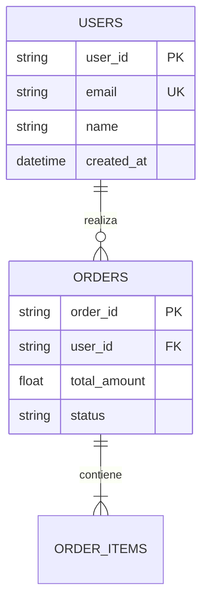

Esquema y Modelado de Base de Datos: Motor usado (SQLite, MySQL), Diagrama ERD (Mermaid.js), diccionario completo de tablas, tipos de datos, llaves primarias/foráneas e índices.


```

---

### 3. `docs/database.md` (Esquema de Base de Datos)

```markdown
# Esquema y Modelado de Base de Datos

## 1. Motor de Persistencia
* **Engine:** SQLite 3 (o MySQL 8.0+)
* **Ubicación:** `storage/database.sqlite`
* **Estrategia de Migraciones:** Migraciones automáticas e idempotentes.

---

## 2. Diagrama Entidad-Relación (ERD)


---

## 3. Diccionario de Tablas

### 3.1 Tabla `users`

| Columna | Tipo | Restricción | Descripción |
| --- | --- | --- | --- |
| `user_id` | VARCHAR(36) | PRIMARY KEY | UUID v4 único del usuario. |
| `email` | VARCHAR(150) | UNIQUE, NOT NULL | Correo electrónico de acceso. |
| `name` | VARCHAR(100) | NOT NULL | Nombre completo. |
| `created_at` | DATETIME | NOT NULL | Fecha de registro en UTC. |

```